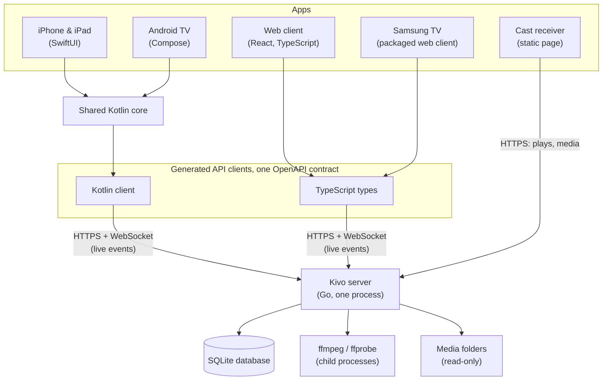
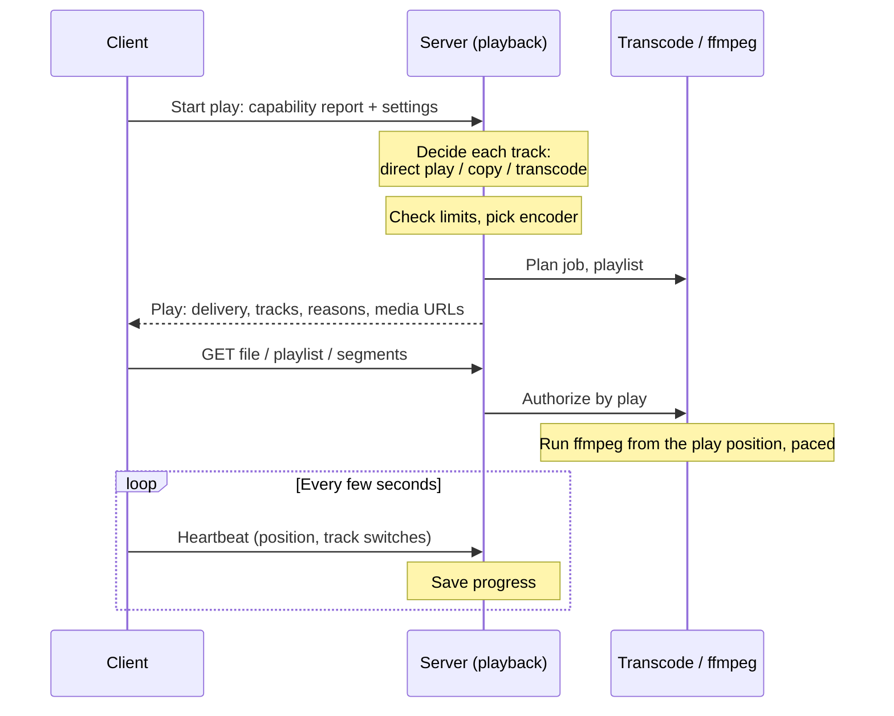

# Kivo architecture

This document covers how Kivo is put together: the parts, the main flows, and the reasons behind the larger design choices. It's for people working on Kivo. Implementation details live in the code.

## What Kivo is

Kivo is a self-hosted media server for one household or a group of friends. It catalogues movies, TV shows, other videos and audiobooks from folders on disk, describes them with metadata from online providers, and streams them to Kivo's own apps on phones, tablets, TVs and browsers.

Its main goals:

- **Watch state is never lost.** Moving, renaming, upgrading or re-identifying a file keeps its history and resume position.
- **Play the file whenever possible.** Kivo prefers playing a file as it is, then repackaging it, and transcodes only what a device can't play, showing the reason.
- **Responsive.** Browsing stays quick during a large first scan, and a far seek in a transcode starts quickly.
- **Safe on the internet.** Every request is authenticated and authorized, and no long-lived secret appears in a URL.
- **Easy to run.** One container (or one binary) with a config directory, a data directory and a cache. The project runs no cloud account, relay or telemetry service.

## The pieces



### The server

The server is one Go process (`server/cmd/kivo`). It serves the HTTP API and the web client, runs the background work, and plans transcodes. It runs ffmpeg and ffprobe as child processes, one per job, so a crash or hang costs one job and never the server. Container parsing that Kivo does itself, such as reading Matroska cues and MP4 boxes, runs in-process.

State lives in SQLite, opened by the pure-Go `ncruces/go-sqlite3` driver, so the server builds without cgo and cross-compiles easily. Queries are SQL files compiled by sqlc. Everything that can be rebuilt (artwork, preview thumbnails, extracted subtitles, transcode segments) lives in the cache directory and can be deleted at any time.

The server's packages live under `server/internal`, one component per package, arranged in layers. A component may import components in its own layer or below, never above, and the imports must stay acyclic:

```
 cmd/kivo   builds every component, wires them together, runs them
 api        HTTP, WebSocket, authentication, access, health pages
 features   scan  identify  previews  subtitles  markers  transcode  playback
 domain     store  config  media  discovery  tasks  users  auth  catalog
            activity  query  metadata  userstate  release
 helpers    fault  id  events  health  keylock  atomicfile  cachedir  egress  parse
            version
```

The main components:

- **`store`** opens the database, runs forward-only migrations, and takes snapshots and backups. It's the only package that knows the SQLite driver.
- **`config`** serves typed settings: bootstrap settings from `server.toml` or `KIVO_*` environment variables, everything else from the database.
- **`catalog`** holds what exists: libraries and their folders, files, tracks, versions, works, people, collections, book series and the search index.
- **`scan`** reconciles the file system into the catalog: it walks and watches folders, probes files and detects moves.
- **`identify`** decides which work each folder and file is, from names, IDs in paths, NFO files and provider searches.
- **`metadata`** fetches provider data and artwork through `egress`, reads NFO files and local artwork, and normalizes it all into the catalog.
- **`media`** is the typed interface to media work: probing, keyframe indexes, artwork re-encoding, transcodes and conversions. Its `ffmpeg` subpackage turns those requests into command lines and its `container` subpackage parses MP4 and Matroska.
- **`transcode`** writes HLS playlists, runs one ffmpeg job per play, handles seeks, paces jobs and stores segments. It also runs download conversions.
- **`playback`** decides how each track of a play is delivered, runs plays, enforces stream limits, authorizes media requests, and plans and prepares downloads.
- **`previews`**, **`subtitles`** and **`markers`** prepare work ahead of time: scrub thumbnails, extracted subtitles and fonts, and intro and credits markers.
- **`users`**, **`auth`** and **`userstate`** hold accounts, permissions, each account's Home layout and lists, credentials and sessions, and watch state and what's in each list.
- **`query`** answers every read the UI needs, filtered by the caller's permissions.
- **`tasks`** runs all background work, and **`events`** fans out live-update hints.
- **`release`** checks once a day whether a newer Kivo release is out, for the admin's notice.
- **`api`** exposes it all over HTTP and WebSocket. It runs no SQL and holds no domain rules, though a handler may combine reads from several services into one response.

Several of these rules are enforced by tests in `internal/archtest` rather than left to review: the layering, that only `egress` makes outbound requests, that each component writes only the tables and columns it owns, and that only `store` begins and ends transactions.

### The API contract

`server/internal/api/openapi.yaml` is the contract between the server and every client. The server generates its request and response types from it with oapi-codegen, and also embeds the spec at run time: each operation's access level is declared there (`x-kivo-access`), and the server refuses to start if an operation lacks one. The web client gets TypeScript types from it with openapi-typescript (`server/web/src/api/schema.d.ts`), and the native apps get a Kotlin client from openapi-generator (`clients/api`). Generated code is committed and checked in CI, so a change to the spec shows up as a change to every client.

The contract is long-lived and grows by addition. Clients treat enum values as open strings and ignore fields they don't know, so an older app keeps working against a newer server. The few enums the native apps branch on (a track's type, its delivery, a play's and a download's delivery, the subtitle mode) are Kotlin enums with an `Unknown` case for a value they don't know.

### The shared Kotlin core

The native apps are two UI codebases on one Kotlin Multiplatform core (`clients/core`). Everything that must behave the same on every device lives there: the server connection and sign-in, server discovery, the play protocol, capability reports, the library repositories, live events, downloads, settings and the words used for formats. The core imports no UI toolkit and no player; each platform implements a handful of small interfaces (the device, the player engine, book audio, the capability probe, download transport and secure storage).

Apps reach the core through two objects in its `session` package: `KivoClient`, one per app, and `KivoSession`, one per signed-in server. Reads are exposed as flows that refresh themselves when live events say something changed. The core talks to the server through the generated `:api` module over Ktor, and keeps downloads in a SQLDelight database. Swift sees the core through SKIE, so suspend functions become `async throws` and flows become async sequences.

### The clients

- **Web** (`server/web`). React and TypeScript, built with Vite, with TanStack Router and Query, hls.js for streams, and JASSUB and libpgs for styled and image subtitles. It holds every admin screen as well as the viewing app, and it's embedded into the server binary at build time. A TV build of the same code (`VITE_KIVO_TV=1`) adds remote-control focus navigation for television screens.
- **iPhone and iPad** (`clients/apple`). SwiftUI, with AVPlayer for playback, its own overlay for styled and image subtitles, background downloads, AirPlay, Picture in Picture, and a Google Cast sender. The project is generated from `project.yml` with XcodeGen.
- **Android TV and Google TV** (`clients/android`). Jetpack Compose with Compose for TV, and Media3 for playback. It runs on Fire TV too. One APK in four modules: `app` (the application and its one activity, which picks the TV or phone interface at launch), `tv` (the TV screens), `mobile` (the phone screens, with downloads and a Google Cast sender) and `platform` (the core's Android implementations, such as the Media3 engine, the capability probe and the downloads' transfers on WorkManager, and the state both interfaces share).
- **Samsung TV** (`clients/tizen`). The web client's TV build packaged into a Tizen web app, so the app's code ships in the package and only data, artwork and media come from the server. It keeps an app session's token rather than a cookie, and uses Samsung's own player for direct play.
- **Cast receiver** (`clients/chromecast`). A Google Cast Web Receiver: a static page with no build step, no server address and no secret in it. One hosted copy serves every Kivo server, since each cast names its own server.

Design tokens (`shared/tokens.json`) are generated into each client's theme. Display tables (`shared/display/`: names of codecs, languages, playback reasons and so on) are shared by the server, the web client and the Kotlin core, and shared test vectors keep their wording identical. The server names tracks and versions from them (`Track.name`, `Track.fullName`, `Version.name`), and clients show those names as sent.

## How things work

### Scanning and identifying media

Scanning answers "which files are present, new, changed or gone", and identification answers "which work is this", in separate packages. A library has one or more folders. A scan walks each folder, skipping directories whose modification time hasn't changed, and records new and changed files in small batches as it goes. Files that have vanished are only marked gone at the end of a run, after safety checks, so a crash mid-walk or an unmounted disk never makes a library look empty. A folder that's unreadable or suddenly empty is flagged unreachable and left alone. Gone files are hidden at once but their rows are kept for a while, so a file that comes back returns with its history.

Changes are found three ways: a file watcher on local disks (fsnotify), a periodic full rescan as a backstop for network shares that send no events, and a scan on request (from the admin pages or another tool).

Each new or changed file is probed with ffprobe. The probe stores tracks, chapters and a summary, and a hash of the file's first and last bytes. When a new file matches a known file that has disappeared (same size, same edge hash), the scan treats it as a move and keeps the old row's ID and everything attached to it.

Identification is a task of its own, which a scan hands its probed files to as it ends. It works per top-level folder. It classifies files (extras, disc rips, multi-part files, ignored files), groups them into versions, and decides which work the folder is. It trusts sources in order: a manual match, an ID in a folder or file name such as `{tmdb-438631}`, an NFO file or embedded tags, the folder structure, and finally the file name alone, which is parsed and searched. The parser (`parse`) follows the folder and naming conventions people already use, and is tested against published fixture sets in `server/testdata/naming`. Audiobooks are identified from their folder layout and tags and then filled in from Audible.

A file shows up as soon as it's probed: before any provider has answered, it appears as a provisional work titled from its name. Metadata and artwork arrive later from TMDb (movies and shows), Audible through Audnexus (books) and the Anime-Lists mapping (anime IDs), all fetched through `egress`. A movie's trailers on YouTube are kept as links; the thumbnail of each is fetched from YouTube's image server (`i.ytimg.com`) by the server and stored like any artwork, so no app loads anything from YouTube until a trailer is opened there.

### Data model and identity

Kivo separates the **work** (what you watch: a movie, a series, a season, an episode, a book), the **version** (one playable copy, made of one or more files) and each account's **state** for a work. Works and versions are many-to-many: a double-episode file is one version covering two works, and a movie split across two files is one version in two parts.

Every row gets a random UUIDv7. No ID is derived from a path, name or hash, which is what lets files move freely. A root work (a movie, series, video or book) is identified with its folder: renaming the folder keeps the work, and fixing a match re-describes the work in place rather than replacing it, so watch state never has to be moved between works. Resume positions are stored on the version's timeline, so a multi-part movie or a book of many files resumes in the right place.

Each component is the only writer of its own tables, and writes that span components share one transaction passed in by the caller. Large writes run in short batches, so interactive requests never wait long behind them.

### Background work

All background work runs as tasks of one in-memory runner (`internal/tasks`): scans, identification, metadata refreshes, previews, markers, subtitle extraction, download preparation, library deletion, cleanups and database backups. Each task is one row on the admin Tasks page.

A task's work is either one function or a list of items, and it runs nightly, every so often, or on demand. The runner keeps no durable queue. A task that works through items reads what's pending from its feature's own tables every time it looks for work (for example, the files with no previews at their current generation), and records each outcome in those same tables. A feature can also enqueue items to be done now; those wait in memory only. So a restart loses nothing: whatever wasn't finished, enqueued or not, is still pending in the database. Every file has a generation number that changes when its content does, and background results are committed only if the generation still matches, so a result for an old version of a file is dropped.

Nightly tasks run in a maintenance window the admin sets. On-demand tasks, such as preparing downloads, have no runs and do items as they're enqueued. Newly added media is enqueued, so it can be processed immediately. Background ffmpeg runs at low OS priority so it stays out of playback's way.

### A play, from capability report to stream



**The capability report.** A client starts a play by reporting what the device can decode, measured on the device: each codec it plays, with ceilings such as profile, level, bit depth, resolution, channels and HDR formats, and whether it works in a whole file, inside an HLS stream, or (for subtitles) as a separate file. The report is facts, never policy. User choices (allow direct play, burn subtitles, quality) travel separately, so a decision can tell "can't" apart from "chose not to".

**The decision.** The server decides each track separately with a pure function, `playback`'s decision ladder, covered by golden tests. The first rung that works wins:

1. **Direct play.** The file as it is, over HTTP range requests.
2. **Direct stream.** The same tracks repackaged into fragmented MP4 over HLS by an ffmpeg copy job. This needs a usable keyframe index in the container.
3. **Audio transcode.** The video is copied and the audio is transcoded.
4. **Video transcode.** On a hardware accelerator when one is available and passed its tests, otherwise on the CPU.

Any track that isn't played directly moves the whole play to HLS, and a burned-in subtitle forces a video transcode. The decision also picks default audio and subtitle tracks from the account's and series' preferences, and prefers a compatible alternative track (such as a same-language Dolby track) over transcoding when one exists.

Every track carries a reason code for its rung, named for the capability or limit it failed, such as an unsupported codec, a bandwidth limit or a missing keyframe index. Clients word these from the shared display tables, so the player's stream info can say exactly why something is transcoding. A play that can't be made at all is refused with its own code, and clients tell "busy, try later" apart from "not playable".

**Transcoding.** A video transcode produces 8-bit SDR H.264, or HEVC where the client plays it and an accelerator can encode it, at no more than 1080p. Each play runs one ffmpeg process from the play position, writing fragmented MP4 to a pipe. Kivo's own splitter (`media/container`, built on mp4ff) cuts it into segments, each served as soon as it's complete, and the full playlist is written up front so the player can seek anywhere. A seek into segments already made is served from disk; a far seek stops the job and starts a new one at the seek point. When a job gets far enough ahead of the player, `transcode` pauses it and resumes it as the player catches up. A play keeps one encoder for its whole life, because all its segments share one initialization segment.

**Fill-to-cap rate control.** A stream's bitrate is a cap it never exceeds: the lowest of the quality the user picked, the account's or server's remote limit for plays from outside the local networks, and a share of measured bandwidth for Auto. Every encoder runs in VBR with the cap as its peak and an average just under it, so a stream fills its budget and stays inside it, the same way on every backend. The quality menu offers a fixed ladder of caps, each labelled with the height a transcode at that cap is sent at.

**Plays and media URLs.** Plays live in memory. The client sends a heartbeat with its position, and a play that stops hearing from its client expires, which stops its job and saves its last position. Media URLs carry the play's random ID rather than a session token. That ID is a narrowly scoped capability: on every request the server resolves the play to its owner and checks current permissions, so revoking access takes effect immediately. If playback fails, the client asks once for a fallback, and the server starts a new play that transcodes everything on the CPU.

**Audio.** The server mixes surround down for stereo clients, keeping dialogue audible, and an optional dialogue boost raises the centre channel. Doing both on the server makes them the same on every client.

**Subtitles.** Text subtitles go to the client as WebVTT, either as a file or inside the stream. Styled ASS and image-based PGS subtitles are extracted ahead of time, with their fonts, so clients that can draw them get files from the first play, and clients that can't get them burned into the video. A play never waits for extraction: one that finds a track not yet extracted shows it another way.

### Downloads

The iPhone, iPad and Android phone apps download books, movies and episodes to play without the server. A download is one version of one work, at one of three tiers:

- **Original.** The file as it is, when the device plays it.
- **High.** A 1080p conversion aimed at a quality suitable for any screen, keeping surround audio.
- **Standard.** A smaller 1080p conversion aimed at phone viewing, with stereo audio.

The server plans a download the way it plans a play, but always as whole files. It sends the original when the device plays it and it's no larger than the tier allows; otherwise it converts to one MP4 per part in **one pass**, copying what it can (remuxing when only the container is wrong, copying video and converting audio when that's enough) and encoding video only when it must. Unlike a stream, a conversion aims at a picture quality under the tier's cap rather than filling the cap, so easy material produces smaller files. Subtitles are prepared before a download is ready, so a finished download is complete even if the device goes offline as soon as it has it.

Downloads are a server resource of their own. A download that needs conversion waits in line for the Downloads task, which prepares them in order at low priority and reports its place in line, progress and time left. Converted files are kept until the app confirms it has them, or for a limited time.

**Transfer** runs in the platform's background transfer service, so it continues with the app closed and resumes by HTTP range after a drop or relaunch; each file's size and SHA-256 are checked on arrival. Progress made offline goes to an outbox that's sent when the server is reachable, and the newest position wins across devices.

### Live events

Clients keep a WebSocket open to `/api/v1/events` while in the foreground. The server publishes small hints on an in-process bus (`internal/events`): a library changed, a user's watch state changed, a play ended, downloads moved, tasks progressed. Events carry only IDs and counts with a scope (a library, a user, admins), never content. Clients react by refetching through the normal API, which applies the caller's permissions.

Delivery is never promised. Bursty kinds are merged and sent at most once per interval, and a subscriber that falls behind gets a resync frame and refetches what's on screen. Nothing is persisted or replayed.

### Sign-in and device linking

Passwords are hashed with argon2id, and sign-in attempts are throttled per address and per account and address, so one attacker can't lock a user out. Session and API tokens are random, stored only as hashes, and never accepted in query strings.

The web client uses an HttpOnly, SameSite cookie. Apps send their session's token in the `Authorization` header. Each app or browser has a client ID, so signing in again from the same device replaces its session rather than adding one. An account can see where it's signed in and sign any session out; a signed-out device is refused at its next request and its event socket closes.

**Device linking** signs in a TV or a phone without typing a password, using an RFC 8628 device authorization grant against the server itself. The new device asks for a short code and shows it along with a QR code of the server's `/link` page. Someone already signed in approves or denies it, at `/link` or from Link a device in an app. The approver sees details the new device can't spoof: its platform, whether it's on the home network, and when it asked. The device polls with a separate secret that never leaves it, so someone who reads the code off the screen can't use it to sign in elsewhere.

**Finding and trusting the server.** The server advertises itself on the local network as a `_kivo._tcp` DNS-SD service (`internal/discovery`), which the apps browse with Bonjour and NSD. An app sends its token to an HTTPS address its certificate vouches for, but to a plain-HTTP address only after that address proves, on the network the device is on now, that it's the same server: the app sends a fresh challenge and the server signs it with its identity key, an ECDSA P-256 key it makes on first start and keeps in its database. The app learns the public key at sign-in (or, signed in before it had one, from the first proof it sees) and checks every proof against it; a server whose key no longer matches signs the app out, and sign-in says the server's identity changed. This keeps a token from going to a different server that happens to use the same private address on another network.

**Casting.** To cast, a signed-in sender creates a short-lived cast token tied to its session and sends it to the receiver over the Cast channel, with the server's ID and addresses. The receiver picks the address that answers as that server, measures the TV's capabilities, and starts and heartbeats the play itself, so the cast continues after the phone leaves. A cast token reaches only the routes a receiver needs, as an ordinary user, and ends with its session.

**Authorization** is default-deny. Every operation's access level is declared in the spec. Something an account can't see returns 404, the same as something that doesn't exist, and tests call every route without credentials and as an account with no library access to check that nothing leaks.

### HDR tone mapping and hardware acceleration

At startup the server finds the devices that might encode video (Intel Quick Sync and VA-API, AMD VA-API, NVIDIA NVENC, Apple VideoToolbox) and test-encodes short clips on each through the real segment pipeline, covering each output codec, decoding, tone mapping and subtitle drawing. It uses only what passed. Admins can leave it on Automatic, choose one accelerator or turn acceleration off, and the transcoding settings explain why an accelerator can't be used.

`transcode` and `media` never choose an accelerator; `playback` does, and names the exact device in each request. If an accelerator is busy or fails before a play's first segment, playback reopens the transcode on the CPU and the play's reason says so. A failure later in the play falls back through the client's fallback request.

HDR sources are tone-mapped to SDR for transcodes, on the GPU when the accelerator supports it and on the CPU otherwise, all to the same target. A Dolby Vision file plays as Dolby Vision on a device that lists its profile, and otherwise by its base layer where that layer is HDR10, HLG or SDR. Profile 7, which can't be rewritten to a single-layer profile, is stripped to HDR10 when its video is copied.

Kivo ships a patched ffmpeg build (jellyfin-ffmpeg) for its GPU tone-mapping filters and driver fixes, as a separate binary in the container image. Running ffmpeg as a separate process keeps the GPL-licensed build at a process boundary and lets it be upgraded on its own.

## Key decisions

**Go and one process.** Most of the server is orchestration, SQL and HTTP, where Go is a good fit, and a pure-Go SQLite driver keeps builds free of cgo. One process with ffmpeg as child jobs is simpler to run than a set of services, and still isolates the part most likely to crash.

**SQLite only.** A household server doesn't need a database server. SQLite in WAL mode, with one writer connection and a read pool, handles the load, and backup is copying a file. The data directory must be on a local disk, since SQLite on network file systems can corrupt.

**Identity that doesn't depend on paths.** Random IDs, move detection by content and the rule that a work is its folder mean watch state survives everything people do to their libraries. A match describes a work; it never moves or merges one.

**The server decides.** Anything two clients would otherwise both work out (the playback rung and its reason, default tracks, next up, sorting, the quality ladder) comes from the server. Clients measure their device, report it and play what they're told. This keeps behavior consistent across platforms and makes new clients cheaper.

**Tasks read their work from the data.** Background tasks keep no queue; they ask the database what's left. There's no queue to drift out of step with the data, and a restart loses nothing.

**A shared core, native UI.** Policy lives once, in Kotlin, and is tested once. Each platform keeps a native UI and its native player, which suits video playback and TV remote navigation better than a shared UI would.

**One path for outbound requests.** All internet requests go through `egress`, which allows HTTPS to public addresses only, checked on the address actually dialled. A provider response can't point the server at the local network.

## Where things live

```
server/
  cmd/kivo/            main, the admin CLI (reset-password, restore), and the one place components are wired
  internal/            one package per component (see "The server" above)
    api/openapi.yaml   the API contract
    archtest/          tests that enforce layering, egress, table ownership and transactions
    media/container/   MP4 and Matroska parsing, keyframes, the fMP4 segment splitter
    media/ffmpeg/      ffmpeg command lines, accelerator detection
    parse/             the file and folder name parser, for video and audiobook paths
    version/           the server's version, which release-please raises, and the version parser
  web/                 the web client (React, TypeScript), embedded into the server at build
  testdata/naming/     naming fixtures from permissively licensed projects
  docker/              the container entrypoint and an Unraid template
  Dockerfile           the server image, with the web client and ffmpeg
  Makefile             build, test, lint, generate
shared/
  tokens.json          design tokens for every client
  display/             display tables and the test vectors the clients share
  brand/               logos and icons
clients/
  api/                 the Kotlin API client, generated from openapi.yaml
  core/                the Kotlin Multiplatform core shared by the native apps
  android/             the Android TV and Google TV app
  apple/               the iPhone and iPad app (SwiftUI, XcodeGen); see FIRST-RUN.md
  tizen/               the Samsung TV packaging of the web client's TV build
  chromecast/          the Google Cast Web Receiver
  tokens/              generators from tokens.json to Compose and SwiftUI themes
  benchmark/           Android performance benchmarks
docs/
  decisions/           architecture decision records
  checklists/          manual release checklists for Safari and TVs
  reverse-proxy.md     running behind a reverse proxy
  reset-password.md    resetting a password from the command line
```
